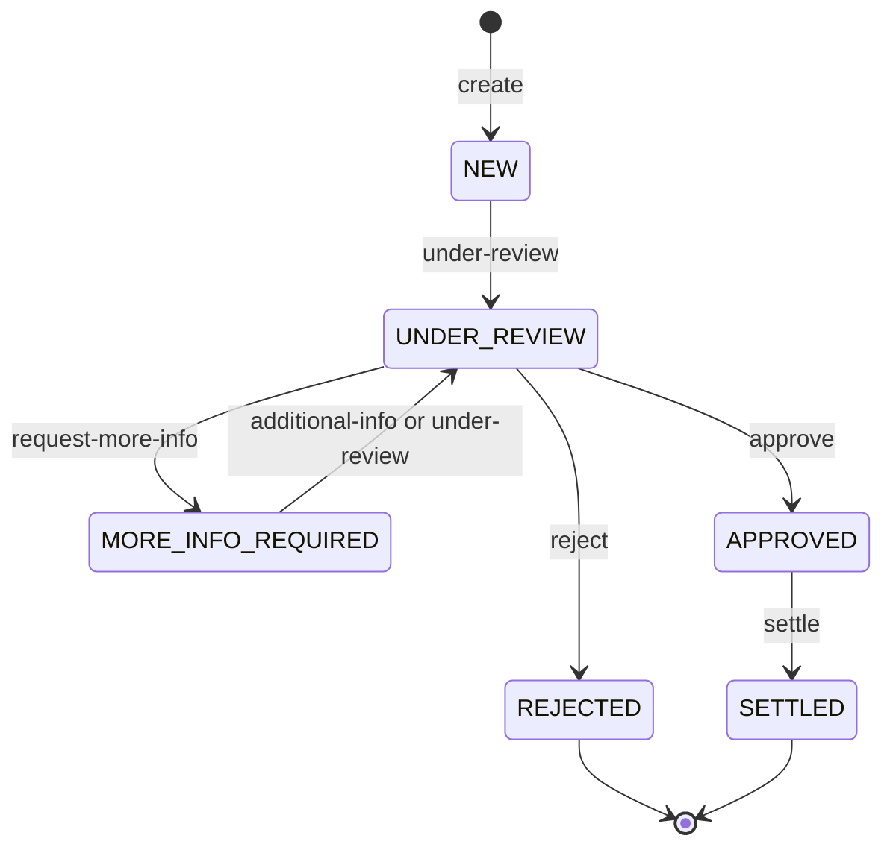
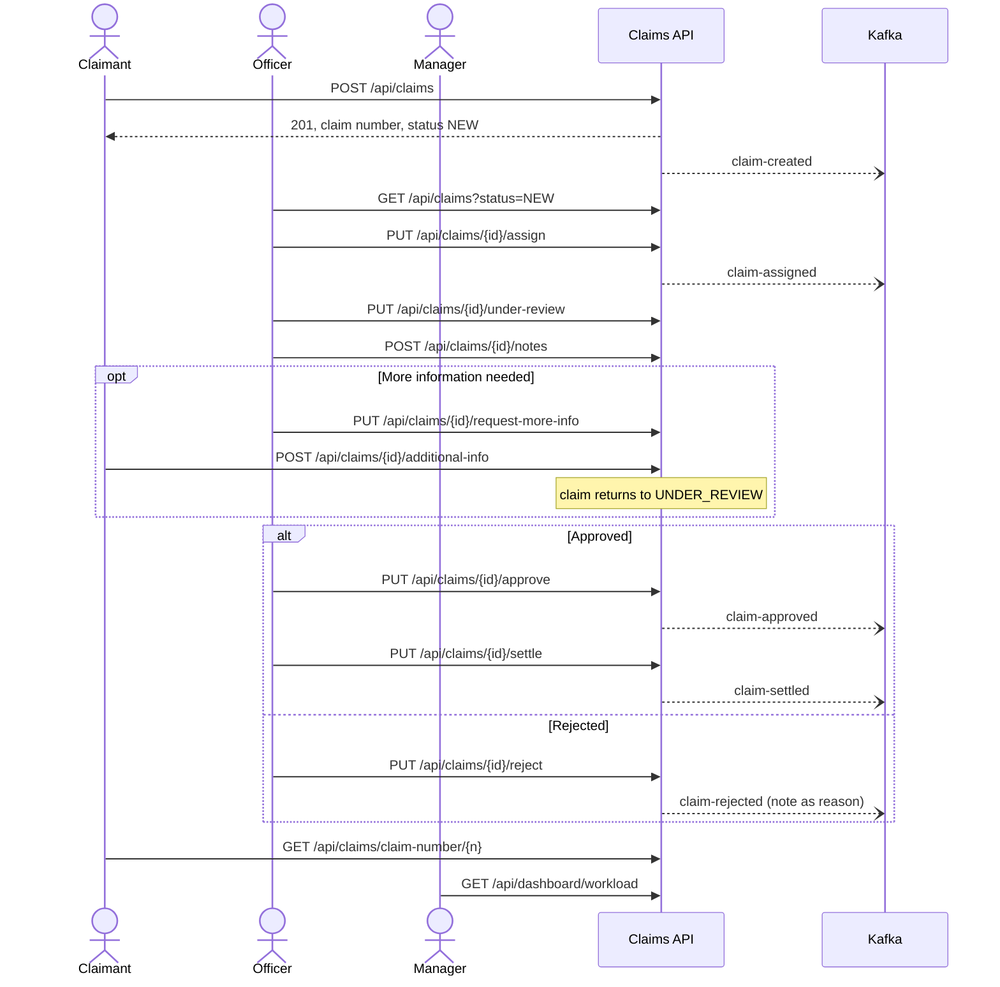

# API endpoints and project flow

Reference for every REST endpoint (as shown in Swagger UI) and the end-to-end claim flow. Derived from the
controllers, services and `application.properties`. For `curl` examples see the [root README](../README.md).

## Swagger and other URLs

Start the app with `mvn spring-boot:run` (port 8080).

| URL | Purpose |
|---|---|
| `/swagger-ui.html` | Swagger UI, endpoints grouped by tag: Claims, Claim Officer, Claim Workflow, Dashboard |
| `/v3/api-docs` | OpenAPI JSON |
| `/h2-console` | H2 console (JDBC URL `jdbc:h2:mem:claimsdb`, user `sa`, empty password) |
| `/actuator/health`, `/actuator/info`, `/actuator/metrics` | Actuator |

## Endpoints (17)

### Claims

| Method | Path | Body or parameters | Success |
|---|---|---|---|
| POST | `/api/claims` | `claimantName`, `claimantEmail`, `policyNumber`, `description`, `incidentDate`, `claimAmount`, `liabilityExposure` | 201 |
| GET | `/api/claims` | `status`, `assignedOfficer`, `policyNumber`, `page`, `size`, `sort` | 200 |
| GET | `/api/claims/{id}` | none | 200 |
| GET | `/api/claims/claim-number/{claimNumber}` | none | 200 |
| PUT | `/api/claims/{id}` | same as create, without `policyNumber` (immutable) | 200 |
| DELETE | `/api/claims/{id}` | none | 200 |

Validation on create and update: `claimantName` and `description` mandatory, `claimantEmail` a valid email,
`incidentDate` not in the future, `claimAmount` and `liabilityExposure` greater than 0. The list defaults to
20 per page, newest first.

### Claim Officer

| Method | Path | Body | Success |
|---|---|---|---|
| PUT | `/api/claims/{id}/assign` | `{"officer": "John Smith"}` | 200 |
| POST | `/api/claims/{id}/notes` | `{"note": "..."}` (up to 4000 characters) | 201 |
| GET | `/api/claims/{id}/notes` | none, oldest first | 200 |

### Claim Workflow

| Method | Path | Moves the claim | Body |
|---|---|---|---|
| PUT | `/api/claims/{id}/under-review` | `NEW` or `MORE_INFO_REQUIRED` → `UNDER_REVIEW` | optional `{"note": "..."}` |
| PUT | `/api/claims/{id}/request-more-info` | `UNDER_REVIEW` → `MORE_INFO_REQUIRED` | optional note |
| POST | `/api/claims/{id}/additional-info` | `MORE_INFO_REQUIRED` → `UNDER_REVIEW` (claimant) | required `{"information": "..."}` |
| PUT | `/api/claims/{id}/approve` | `UNDER_REVIEW` → `APPROVED` | optional note |
| PUT | `/api/claims/{id}/reject` | `UNDER_REVIEW` → `REJECTED` | optional note (the reason) |
| PUT | `/api/claims/{id}/settle` | `APPROVED` → `SETTLED` | optional note |

A non-blank note on any of these is stored as a `ClaimNote`.

### Dashboard

| Method | Path | Returns |
|---|---|---|
| GET | `/api/dashboard/workload` | `totalOpenClaims`, `totalLiabilityExposure`, `claimsByStatus`, `claimsPerOfficer` |
| GET | `/api/officers/{officer}/workload` | `officer`, `openClaims`, `totalLiabilityExposure`, `claimsByStatus` |

### Responses and errors

- Claim, note and workflow endpoints return the envelope `{success, message, data}`. Both dashboard endpoints
  return bare JSON, as specified.
- **400** validation failed or malformed request. **404** claim not found.
- **409** invalid transition, edit or assign on a final claim, or a concurrent update (optimistic lock).

## Claim lifecycle

Any other transition is refused with `BusinessException` (HTTP 409). `REJECTED` and `SETTLED` are final.

## End-to-end flow

1. **Create.** The claimant posts a claim. It gets a generated claim number and status `NEW`.
2. **Pick up.** An officer lists `NEW` claims, assigns one and moves it to `UNDER_REVIEW`.
3. **Review.** The officer adds notes. If something is missing they request more information; the claimant
   submits it and the claim returns to `UNDER_REVIEW`. This loop can repeat.
4. **Decide.** The officer approves and later settles the claim, or rejects it.
5. **Track and monitor.** The claimant reads the claim by id or claim number. Managers use the dashboard; open
   claims are `NEW`, `UNDER_REVIEW` and `MORE_INFO_REQUIRED`.

### Inside one request

Controller → `@Transactional` service → `ClaimTransitionValidator` → repository → database. If the claim was
saved, the Kafka event is sent after the commit, keyed by claim number. Sending is best-effort. Exceptions are
turned into the error envelope by `GlobalExceptionHandler`.

### Kafka events

| Topic | Published by |
|---|---|
| `claim-created` | `POST /api/claims` |
| `claim-assigned` | `PUT /api/claims/{id}/assign` |
| `claim-approved` | `PUT /api/claims/{id}/approve` |
| `claim-rejected` | `PUT /api/claims/{id}/reject` |
| `claim-settled` | `PUT /api/claims/{id}/settle` |

Review steps (`under-review`, `request-more-info`, `additional-info`) and notes publish nothing.

## Behaviours worth knowing

- **Slow responses without Kafka.** If no broker is running, each event send can hold the request for up to
  5 seconds (`max.block.ms`). The API still succeeds. Run `docker compose up -d` first for a smooth demo.
- **List filters.** Only one filter applies, in the order `status`, then `assignedOfficer`, then `policyNumber`.
- **Assignment is independent of status.** Nothing forces assigning before review, and it works in any
  non-final status.
- **Final claims.** `REJECTED` and `SETTLED` claims cannot be edited or reassigned, but notes can still be added.
  `DELETE` has no status check, so it removes a claim in any state together with its notes.
- **Dashboard.** `claimsByStatus` always lists every status (zero when empty). `claimsPerOfficer` counts open
  claims only, busiest first, and leaves out unassigned claims.
