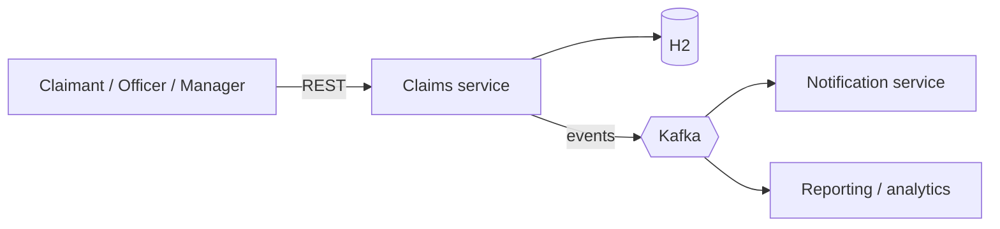
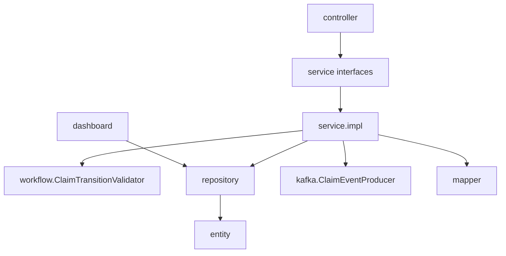
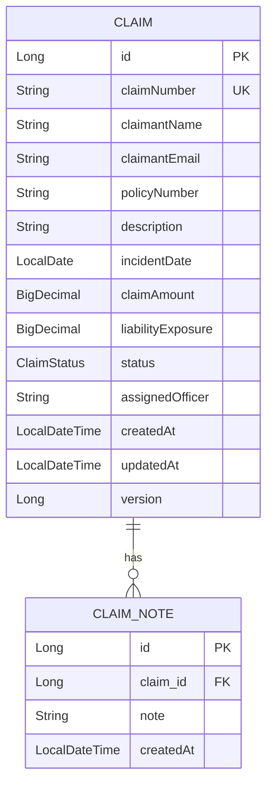
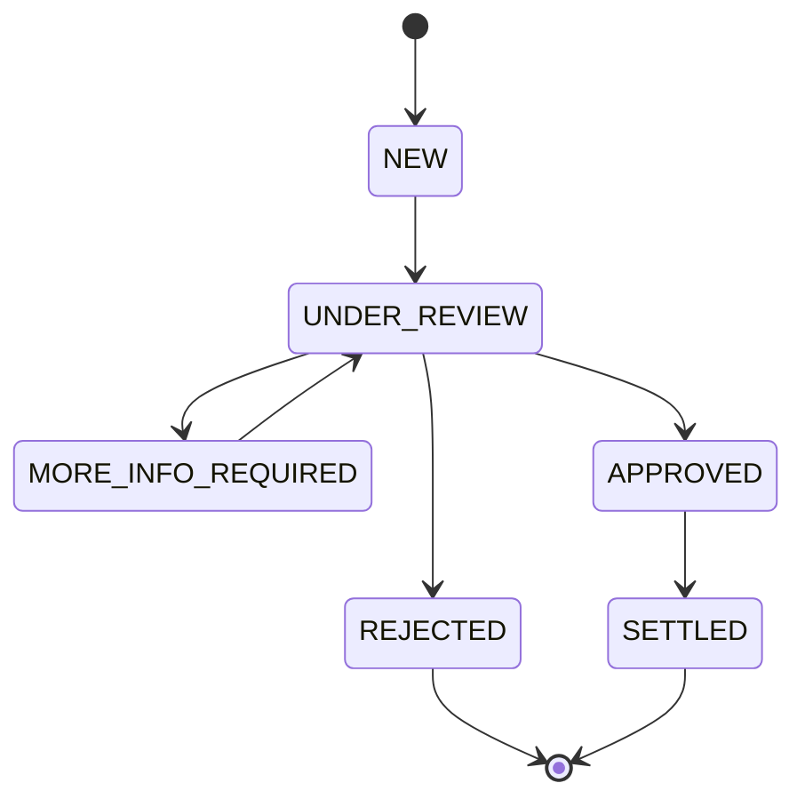

# Architecture

## Context

A single Spring Boot service exposes REST APIs to claimants, officers and managers, stores data in a
relational database and publishes lifecycle events to Kafka for other systems.

## Layers

Controllers only translate HTTP to service calls. Services own business rules and transactions.
Repositories own queries. `GlobalExceptionHandler` converts exceptions to the response envelope.

## Domain model

- `ClaimNote.claim` is the owning side (`@ManyToOne(fetch = LAZY)`, `claim_id` not null). `Claim.notes` is the
  inverse side (`mappedBy`), cascades all operations and removes orphans, so deleting a claim deletes its notes.
- Timestamps are filled by Spring Data auditing; `version` gives optimistic locking.
- `assignedOfficer` is a plain string (no officer table yet, see future enhancements).

## Claim lifecycle

Rules are encoded once in `ClaimTransitionValidator`. Invalid moves throw `BusinessException` (HTTP 409).
Final states (`REJECTED`, `SETTLED`) block edits and re-assignment, but notes can still be added so the
history stays complete.

## Event flow

1. A service method changes the claim and saves it inside a transaction.
2. `ClaimEventProducer` registers a transaction synchronisation; the message is sent in `afterCommit`.
3. The message goes to a topic per event type, keyed by claim number (ordering per claim).
4. Send failures are logged and never fail the API call.

## Dashboard queries

All metrics are JPQL aggregations in `ClaimRepository`; no claim rows are loaded.

- open claims count and total exposure: `status in (NEW, UNDER_REVIEW, MORE_INFO_REQUIRED)`
- claims by status: `group by status` over all claims, zero-filled in the service
- claims per officer: open claims grouped by `assignedOfficer`, busiest first, unassigned excluded

## Trade-offs

| Decision | Benefit | Cost |
|---|---|---|
| Single deployable (modular monolith) | Simple to build, test and run; one transaction boundary | Scales as one unit; module boundaries are by convention only |
| H2 in-memory | Zero setup for the assessment | Data lost on restart |
| `ddl-auto=update` | Fast iteration | Not safe for production; needs Flyway/Liquibase |
| Publish after commit, best effort | Never emits events for rolled-back data; broker outage does not break the API | An event can be lost if the process dies between commit and send, or the broker is down |
| Hand-written mappers | No extra dependency, explicit | More boilerplate than MapStruct |
| Officer stored as a string | Matches the required model, minimal | No validation that the officer exists, no officer attributes, names can drift |
| Open = NEW, UNDER_REVIEW, MORE_INFO_REQUIRED | Matches the requirement | `APPROVED` claims (awaiting payment) do not count towards open exposure |
| Dashboard computed on demand | Always current, no stale cache | Load grows with data volume; fine for assessment scale |
| Optimistic locking | No lock contention | A concurrent update fails with 409 and the client must retry |
| Dashboard returns bare JSON, other APIs use an envelope | Follows the stated contract | Two response styles |

## Future enhancements

- **Schema migrations (Flyway/Liquibase)**: versioned migrations and `ddl-auto=validate` instead of
  `ddl-auto=update`, indexes reviewed against real queries.
- **Transactional outbox**: write events to an outbox table in the same transaction and relay them to
  Kafka, giving at-least-once delivery without loss.
- **Consumers**: a notification service for claim decisions (email to the claimant) with idempotency on `eventId`,
  and a dead-letter topic for poison messages.
- **Security**: authentication (OAuth2/OIDC), roles for claimant, officer and manager, claimants limited to
  their own claims, officers to their workload.
- **Officer entity**: an officer table (the personal workload endpoint currently matches the assigned-officer name as text), capacity-aware assignment.
- **Claimant identity checks**: let claimants see or update only their own claims (claim number plus email, or login).
- **Multi-market support**: market/region on claims and policies, currency handling, per-market dashboards.
- **Observability**: Micrometer metrics for transitions and publish failures, tracing, structured logs.
- **Dashboard scale**: caching or a read model once data volume grows; filters by market, officer and period.
- **Audit trail**: record every status change (who, when, from, to) in a history table.
- **SLA tracking**: age of claims in each state and alerts for stale claims.
