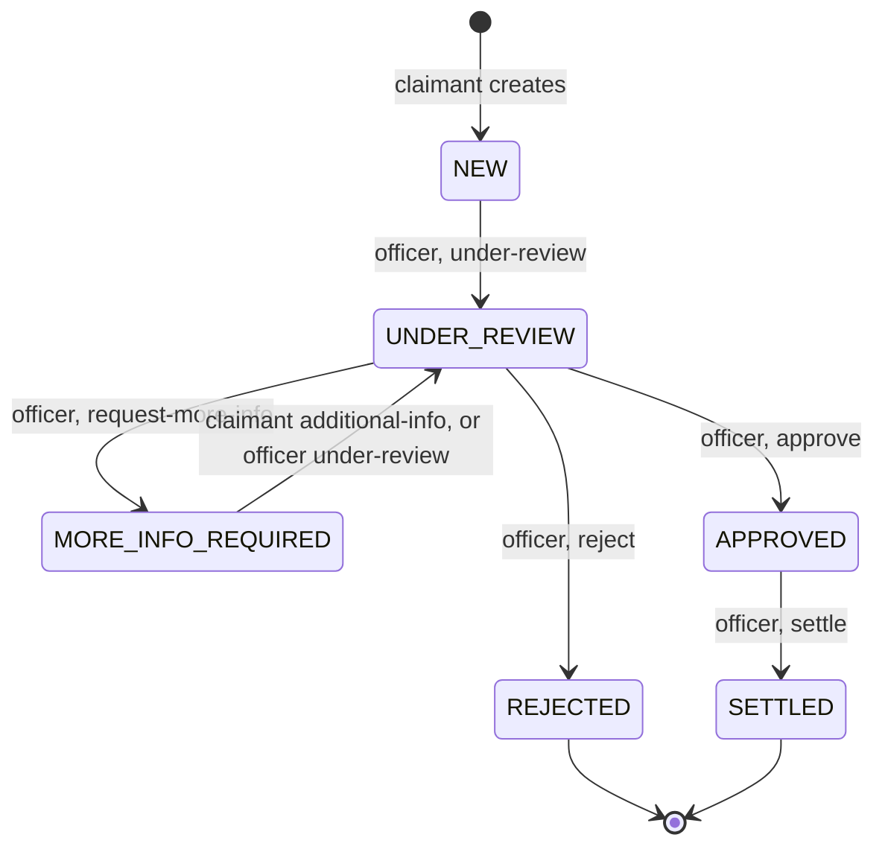
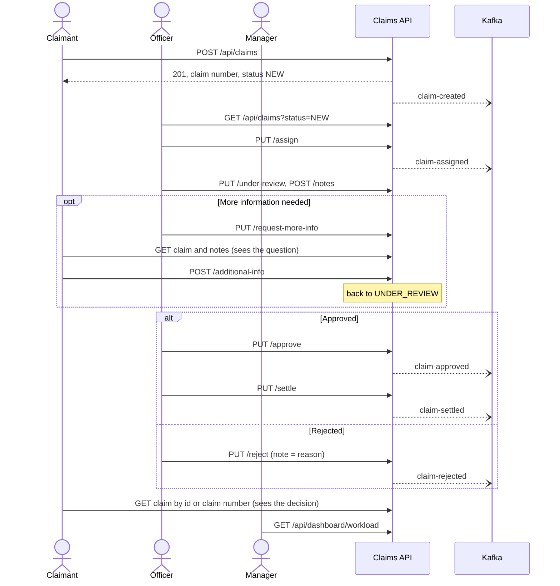

# Complete flow, roles and testing guide

One document that answers four questions: **what does the system do, who are the roles and how do they work,
how do I run it, and how do I test every part of it.** Everything marked *verified* was run against this project
on a clean instance (details in [section 11](#11-what-was-run-to-verify-this-guide)).

Related documents: [api-flow.md](api-flow.md) (endpoint reference), [swagger-test-guide.md](swagger-test-guide.md)
(54-step Swagger script with every error case), [project-workflow.txt](project-workflow.txt) (talking-points
version), [`postman/`](../postman) (Postman collection).

## Contents

1. [The project in one minute](#1-the-project-in-one-minute)
2. [Roles: who they are and how they work](#2-roles-who-they-are-and-how-they-work)
3. [The complete flow](#3-the-complete-flow)
4. [Run it](#4-run-it)
5. [How to test: five layers](#5-how-to-test-five-layers)
6. [Role-by-role walkthrough (run and check every step)](#6-role-by-role-walkthrough)
7. [Database checks (H2 console)](#7-database-checks-h2-console)
8. [Kafka checks](#8-kafka-checks)
9. [Error cases per role](#9-error-cases-per-role)
10. [Troubleshooting](#10-troubleshooting)
11. [What was run to verify this guide](#11-what-was-run-to-verify-this-guide)

---

## 1. The project in one minute

A Spring Boot backend (Java 21, port 8080) for insurance claims. There is no frontend: you use it through
**Swagger UI**. A claim is created, picked up by an officer, reviewed, approved or rejected, and settled.
Managers watch a dashboard of open claims and money at risk.

| Piece | What it does |
|---|---|
| REST API (17 endpoints) | Create, read, update and delete claims, move them through the lifecycle, add notes, show dashboards |
| H2 database (in memory) | Tables `CLAIMS` and `CLAIM_NOTES`. **Wiped on every restart.** |
| `ClaimTransitionValidator` | The one place that decides which status changes are allowed |
| Kafka (optional) | Five topics receive an event after key actions. Nothing in the project consumes them yet. |
| Swagger UI | `http://localhost:8080/swagger-ui.html`, the way you test everything |

## 2. Roles: who they are and how they work

### 2.1 The three roles

| Role | What they want to do | Endpoints they use | How they find out the result |
|---|---|---|---|
| **Claimant** (the customer) | Report an incident, check progress, send extra information when asked | `POST /api/claims`, `GET /api/claims/{id}`, `GET /api/claims/claim-number/{claimNumber}`, `GET /api/claims/{id}/notes`, `POST /api/claims/{id}/additional-info` | Reads the claim's `status`. The officer's request for information is in the claim's notes. |
| **Claims officer** (staff) | See incoming claims, take ownership, review, ask questions, decide, pay | `GET /api/claims` (filter `status=NEW` for the inbox), `PUT /assign`, `PUT /under-review`, `POST` and `GET /notes`, `PUT /request-more-info`, `PUT /approve`, `PUT /reject`, `PUT /settle`, `GET /api/officers/{officer}/workload` | Response of each call |
| **Manager** | See team workload and money at risk | `GET /api/dashboard/workload`, `GET /api/claims?status=...` | The dashboard JSON |

Update (`PUT /api/claims/{id}`) and delete (`DELETE /api/claims/{id}`) are not given to any role in the project
brief. Treat them as back-office actions.

### 2.2 How roles work in the code today: they are not enforced

This is the most important thing to know when testing.

- There is **no login, no token and no permission check**. The project has no Spring Security.
- Roles are a **convention**: they describe who is *supposed* to call which endpoint. The API does not check who
  is calling.
- The only rules the API enforces are about the **claim's status**, not the caller. For example, `approve` works
  only on an `UNDER_REVIEW` claim, whoever calls it.
- The officer is just a **text name** on the claim (`assignedOfficer`). It is not a user account, so there is no
  check that the name exists.

*Verified in stage 7 of the walkthrough:* a "claimant" calling `PUT /api/claims/3/approve` on their own claim
gets **200** and the claim becomes `APPROVED`.

**What this means for you:** in Swagger you play each role simply by choosing that role's endpoints. There is no
**Authorize** button and nothing to log in to. The planned fix (OAuth2 with claimant, officer and manager roles,
claimants limited to their own claims) is listed under Security in [architecture.md](architecture.md).

### 2.3 Who is meant to call what

"Intended" follows the business requirements in [requirements.md](requirements.md). One addition: the claimant
reading notes is not in the brief, but it is how they see what an officer asked for.

| Endpoint | Claimant | Officer | Manager |
|---|:-:|:-:|:-:|
| `POST /api/claims` | ✔ | | |
| `GET /api/claims/{id}` and `/claim-number/{n}` | ✔ | ✔ | ✔ |
| `GET /api/claims` (list and filters) | | ✔ | ✔ |
| `GET /api/claims/{id}/notes` | ✔ | ✔ | |
| `PUT /api/claims/{id}/assign` | | ✔ | |
| `PUT /api/claims/{id}/under-review` | | ✔ | |
| `POST /api/claims/{id}/notes` | | ✔ | |
| `PUT /api/claims/{id}/request-more-info` | | ✔ | |
| `POST /api/claims/{id}/additional-info` | ✔ | | |
| `PUT /api/claims/{id}/approve`, `/reject`, `/settle` | | ✔ | |
| `GET /api/officers/{officer}/workload` | | ✔ | |
| `GET /api/dashboard/workload` | | | ✔ |

All rows work for every caller today (see 2.2). The table is what a future security layer would enforce.

## 3. The complete flow

### 3.1 Claim lifecycle



`REJECTED` and `SETTLED` are final: the claim can no longer be edited, reassigned or moved. Notes can still be
added. Any other move returns **409**.

### 3.2 Which endpoint works in which status

| Current status | Endpoints that move the claim | Also allowed |
|---|---|---|
| `NEW` | `PUT /under-review` | assign, notes, update |
| `UNDER_REVIEW` | `PUT /request-more-info`, `PUT /approve`, `PUT /reject` | assign, notes, update |
| `MORE_INFO_REQUIRED` | `POST /additional-info`, `PUT /under-review` | assign, notes, update |
| `APPROVED` | `PUT /settle` | assign, notes, update |
| `REJECTED` (final) | none | notes only |
| `SETTLED` (final) | none | notes only |

### 3.3 End-to-end story



### 3.4 What happens inside one request (example: approve)

1. `ClaimWorkflowController` receives `PUT /api/claims/1/approve`.
2. The service loads the claim (**404** if missing).
3. `ClaimTransitionValidator` checks `UNDER_REVIEW -> APPROVED` is allowed (**409** if not).
4. The status is set, an optional note is saved as a `ClaimNote`, the claim is saved: **one transaction**.
5. After the commit, `ClaimEventProducer` sends the event to `claim-approved`. If Kafka is down the failure is
   only logged.
6. The result is wrapped as `{success, message, data}`. Any exception becomes the same envelope through
   `GlobalExceptionHandler` (400, 404, 409, 500).

The dashboard endpoints are the exception: they return plain JSON, without the envelope.

## 4. Run it

### 4.1 Start

| Step | Command or action |
|---|---|
| (Optional) Kafka | `docker compose up -d` in the project folder. Start it **before** the app. |
| Start the app | In IntelliJ run `ClaimsManagementApplication`, or in a terminal `mvn spring-boot:run` |
| Wait for the log line | `Started ClaimsManagementApplication` |
| Open Swagger | <http://localhost:8080/swagger-ui.html> |

If `mvn` is not recognised in your terminal, use IntelliJ's Maven tool window (Plugins, `spring-boot`,
`spring-boot:run`) or run the app from IntelliJ.

Without Kafka the app starts in **about 45 to 50 seconds** (measured), and the log shows
`KafkaAdmin - Could not configure topics`. That is harmless. Every call that publishes an event then takes
about 5 seconds.

**Before you start, check that port 8080 is free.** If another copy is already running, your new one stops with
`Port 8080 was already in use`, and Swagger silently talks to the *old* copy (see
[section 10](#10-troubleshooting)).

### 4.2 URLs

| URL | Purpose |
|---|---|
| `/swagger-ui.html` | Swagger UI. Tags: Claims, Claims Officer, Claim Workflow, Dashboard |
| `/v3/api-docs` | OpenAPI JSON |
| `/h2-console` | Database viewer. JDBC URL `jdbc:h2:mem:claimsdb`, user `sa`, empty password |
| `/actuator/health` | Should return `{"status":"UP"}` |
| `/actuator/info`, `/actuator/metrics` | Other actuator endpoints that are exposed |

### 4.3 Swagger rules for testing

- **Restart the app before a full run.** Data lives in memory, so a restart gives ids starting at 1. This guide
  assumes a fresh start (four claims get ids 1 to 4).
- **List claims:** replace the pre-filled `pageable` box with `{"page":0,"size":20}`. Executing the default value
  returns **500**.
- **Workflow endpoints** pre-fill `{"note":"string"}`. Replace it with `{}` or a real note, otherwise a note with
  the text `string` is saved.

## 5. How to test: five layers

| Layer | What it proves | How |
|---|---|---|
| 1. Automated tests | Business rules, validation, queries and Kafka events work | `mvn test` |
| 2. Swagger walkthrough | The real running API behaves correctly for each role | [Section 6](#6-role-by-role-walkthrough) |
| 3. Database check | What the API says matches what is stored | [Section 7](#7-database-checks-h2-console) |
| 4. Kafka check | The right event reaches the right topic | [Section 8](#8-kafka-checks) |
| 5. Health check | The app is up | Open `/actuator/health` |

### Layer 1: automated tests (82)

```bash
mvn test
```

Single class: `mvn -Dtest=ClaimLifecycleIntegrationTest test`. In IntelliJ: right-click the `src/test/java` folder
and choose **Run 'All Tests'**.

| Test class | Tests | What it covers |
|---|--:|---|
| `ClaimTransitionValidatorTest` | 4 | The allowed and refused status changes |
| `ClaimServiceImplTest` | 7 | Create, read, update, delete rules |
| `ClaimWorkflowServiceImplTest` | 17 | Every lifecycle action, notes, events |
| `ClaimAssignmentServiceImplTest` | 4 | Assign and reassign, final-claim refusal |
| `ClaimNoteServiceImplTest` | 4 | Adding and listing notes |
| `DashboardServiceImplTest` | 3 | Workload numbers |
| `ClaimEventProducerTest` | 5 | Events are built and sent, failures are swallowed |
| `ClaimControllerTest`, `ClaimOfficerControllerTest`, `ClaimWorkflowControllerTest`, `DashboardControllerTest` | 7, 6, 8, 2 | HTTP status codes, validation, response envelope |
| `ClaimRepositoryTest` | 10 | The queries behind the dashboard, on H2 |
| `ClaimLifecycleIntegrationTest` | 5 | Full app with an **embedded Kafka broker**: create, assign, approve, settle, reject over HTTP, and the event on each topic |

*Verified:* **82 tests, 0 failures, BUILD SUCCESS.**

## 6. Role-by-role walkthrough

Run the stages in order on a freshly started app. Each row: do it, then compare with **Expect**. "Event" is the
Kafka topic that receives a message (section 8). Bodies for steps that need one are in 6.1 and in the tables.

Swagger tags: **Claims**, **Claims Officer**, **Claim Workflow**, **Dashboard**.

### 6.1 The four claims used

| Claim | id | Claimant | Policy | claimAmount | liabilityExposure | Path |
|---|--:|---|---|--:|--:|---|
| A | 1 | Asha Verma | POL-100234 | 45000.00 | 30000.00 | settled |
| B | 2 | Rohan Mehta | POL-200567 | 120000.00 | 90000.00 | more info, then rejected |
| C | 3 | Priya Nair | POL-300891 | 8000.00 | 5000.00 | stays under review |
| D | 4 | Karan Shah | POL-400112 | 15000.00 | 12000.00 | stays new |

```json
{ "claimantName": "Asha Verma", "claimantEmail": "asha.verma@example.com", "policyNumber": "POL-100234",
  "description": "Rear-end collision at traffic signal, bumper and boot damage",
  "incidentDate": "2026-09-15", "claimAmount": 45000.00, "liabilityExposure": 30000.00 }
```

```json
{ "claimantName": "Rohan Mehta", "claimantEmail": "rohan.mehta@example.com", "policyNumber": "POL-200567",
  "description": "Water damage to warehouse stock after pipe burst",
  "incidentDate": "2026-09-20", "claimAmount": 120000.00, "liabilityExposure": 90000.00 }
```

```json
{ "claimantName": "Priya Nair", "claimantEmail": "priya.nair@example.com", "policyNumber": "POL-300891",
  "description": "Laptop stolen from office",
  "incidentDate": "2026-10-05", "claimAmount": 8000.00, "liabilityExposure": 5000.00 }
```

```json
{ "claimantName": "Karan Shah", "claimantEmail": "karan.shah@example.com", "policyNumber": "POL-400112",
  "description": "Minor fire damage to kitchen",
  "incidentDate": "2026-10-10", "claimAmount": 15000.00, "liabilityExposure": 12000.00 }
```

### Stage 1. Claimant: report incidents and track them

| Step | Endpoint | id or parameter | Body | Expect | Event |
|---|---|---|---|---|---|
| 1.1 | Claims, `POST /api/claims` | | claim A | **201**, `id` 1, `status` `NEW`, `claimNumber` like `CLM-AEB9543816E1` (copy it) | `claim-created` |
| 1.2 | `POST /api/claims` | | claim B | **201**, `id` 2 | `claim-created` |
| 1.3 | `POST /api/claims` | | claim C | **201**, `id` 3 | `claim-created` |
| 1.4 | `POST /api/claims` | | claim D | **201**, `id` 4 | `claim-created` |
| 1.5 | `GET /api/claims/{id}` | `id` 1 | | **200**, `status` `NEW`, no `assignedOfficer` yet | |
| 1.6 | `GET /api/claims/claim-number/{claimNumber}` | the number from 1.1 | | **200**, same claim as 1.5 | |

### Stage 2. Officer: pick up and review

| Step | Endpoint | id or parameter | Body | Expect | Event |
|---|---|---|---|---|---|
| 2.1 | `GET /api/claims` (inbox) | `status` `NEW`, `pageable` `{"page":0,"size":20}` | | **200**, `totalElements` 4 | |
| 2.2 | Claims Officer, `PUT /api/claims/{id}/assign` | `id` 1 | `{"officer": "John Smith"}` | **200**, `assignedOfficer` `John Smith`, `status` still `NEW` | `claim-assigned` |
| 2.3 | `PUT /api/claims/{id}/assign` | `id` 2 | `{"officer": "Mary Jones"}` | **200** | `claim-assigned` |
| 2.4 | `PUT /api/claims/{id}/assign` | `id` 3 | `{"officer": "John Smith"}` | **200** | `claim-assigned` |
| 2.5 | Claim Workflow, `PUT /api/claims/{id}/under-review` | `id` 1 | `{"note": "Starting review"}` | **200**, `status` `UNDER_REVIEW` | none |
| 2.6 | `PUT /api/claims/{id}/under-review` | `id` 2 | `{}` | **200**, `UNDER_REVIEW` | none |
| 2.7 | `PUT /api/claims/{id}/under-review` | `id` 3 | `{}` | **200**, `UNDER_REVIEW` | none |
| 2.8 | Claims Officer, `POST /api/claims/{id}/notes` | `id` 1 | `{"note": "Police report received and verified."}` | **201**, `claimId` 1 | none |
| 2.9 | `GET /api/claims/{id}/notes` | `id` 1 | | **200**, the notes oldest first | |

### Stage 3. Officer asks for information, claimant answers

| Step | Role | Endpoint | id | Body | Expect |
|---|---|---|--:|---|---|
| 3.1 | Officer | `PUT /api/claims/{id}/request-more-info` | 2 | `{"note": "Please send plumber invoice and photos"}` | **200**, `MORE_INFO_REQUIRED` |
| 3.2 | Claimant | `GET /api/claims/{id}` | 2 | | **200**, `status` `MORE_INFO_REQUIRED`. The question is in `GET /api/claims/2/notes`. |
| 3.3 | Claimant | `POST /api/claims/{id}/additional-info` | 2 | `{"information": "Plumber invoice #4471 and 12 photos uploaded to the shared drive"}` | **200**, message `Additional information received, claim is back under review`, `status` `UNDER_REVIEW`. The text is stored as a note starting `Additional information from claimant:`. |

No event is published for these three steps, and the claimant is not notified: they must look at the claim.

### Stage 4. Officer decides, claimant sees the result

| Step | Role | Endpoint | id | Body | Expect | Event |
|---|---|---|--:|---|---|---|
| 4.1 | Officer | `PUT /api/claims/{id}/approve` | 1 | `{"note": "Documents verified, approved for payout"}` | **200**, `APPROVED` | `claim-approved` |
| 4.2 | Officer | `PUT /api/claims/{id}/settle` | 1 | `{"note": "Paid via bank transfer"}` | **200**, `SETTLED` | `claim-settled` |
| 4.3 | Officer | `PUT /api/claims/{id}/reject` | 2 | `{"note": "Damage pre-dates policy start date"}` | **200**, `REJECTED` | `claim-rejected` (the note is the `reason`) |
| 4.4 | Claimant | `GET /api/claims/claim-number/{claimNumber}` | claim A's number | | **200**, `SETTLED` | |
| 4.5 | Claimant | `GET /api/claims/{id}` | 2 | | **200**, `REJECTED` | |

### Stage 5. Officer: personal workload

| Step | Endpoint | Parameter | Expect |
|---|---|---|---|
| 5.1 | Dashboard, `GET /api/officers/{officer}/workload` | `officer` `John Smith` | **200**: `openClaims` 1, `totalLiabilityExposure` 5000.00, `claimsByStatus` `UNDER_REVIEW` 1 and `SETTLED` 1, the rest 0 |
| 5.2 | `GET /api/officers/{officer}/workload` | `officer` `Mary Jones` | **200**: `openClaims` 0, exposure 0, `REJECTED` 1 |
| 5.3 | `GET /api/claims` | `assignedOfficer` `John Smith`, `pageable` `{"page":0,"size":20}` | **200**, `totalElements` 2 (claims A and C) |

The name must match exactly. An unknown name returns **200** with zeros, not an error.

### Stage 6. Manager: dashboard

**Step 6.1: `GET /api/dashboard/workload`.** Expect **200**:

```json
{
  "totalOpenClaims": 2,
  "totalLiabilityExposure": 17000.00,
  "claimsByStatus": {
    "NEW": 1, "UNDER_REVIEW": 1, "MORE_INFO_REQUIRED": 0,
    "APPROVED": 0, "REJECTED": 1, "SETTLED": 1
  },
  "claimsPerOfficer": { "John Smith": 1 }
}
```

Why: "open" means `NEW`, `UNDER_REVIEW` or `MORE_INFO_REQUIRED`. Only C (5000) and D (12000) are open. D has no
officer, so it is not in `claimsPerOfficer`.

| Step | Endpoint | Parameter | Expect |
|---|---|---|---|
| 6.2 | `GET /api/claims` | `status` `REJECTED`, `pageable` `{"page":0,"size":20}` | **200**, `totalElements` 1 |
| 6.3 | `GET /api/claims` | `status` `SETTLED`, same `pageable` | **200**, `totalElements` 1 |

### Stage 7. Role-enforcement check

This stage shows that roles are not enforced. Run it last: it changes the data.

| Step | Who "calls" | Request | Expect |
|---|---|---|---|
| 7.1 | A claimant approving their own claim | `PUT /api/claims/3/approve` | **200**, `APPROVED`. Nothing stopped them. |
| 7.2 | A claimant deleting a claim | `DELETE /api/claims/4` | **200**. Delete works in any status. |
| 7.3 | Anyone assigning a settled claim | `PUT /api/claims/1/assign` with `{"officer": "Manager Mike"}` | **409**, `Claim 1 cannot be assigned because it is SETTLED`. This rule is about **status**, not role. |
| 7.4 | Manager | `GET /api/dashboard/workload` | `totalOpenClaims` 0, `totalLiabilityExposure` 0, `APPROVED` 1, `REJECTED` 1, `SETTLED` 1, `claimsPerOfficer` `{}`. An `APPROVED` claim is not counted as open. |

Restart the app afterwards to get clean data again.

## 7. Database checks (H2 console)

1. Open <http://localhost:8080/h2-console>.
2. Set **JDBC URL** to `jdbc:h2:mem:claimsdb` (the default box says `jdbc:h2:~/test`, change it). User `sa`,
   password empty. Click **Connect**.
3. You should see tables `CLAIMS` and `CLAIM_NOTES`. Paste a query and press **Ctrl+Enter**.

**Claims, with the optimistic-lock counter.** `VERSION` goes up by one on every change to the claim.

```sql
SELECT ID, CLAIM_NUMBER, STATUS, ASSIGNED_OFFICER, LIABILITY_EXPOSURE, VERSION FROM CLAIMS ORDER BY ID
```

After stage 7, expect 3 rows: id 1 `SETTLED` / John Smith / 30000.00 / version 4, id 2 `REJECTED` / Mary Jones /
90000.00 / version 5, id 3 `APPROVED` / John Smith / 5000.00 / version 3. Claim 4 was deleted.

**Notes, joined to their claim.**

```sql
SELECT n.ID, n.CLAIM_ID, c.STATUS AS CLAIM_STATUS, n.NOTE
FROM CLAIM_NOTES n JOIN CLAIMS c ON c.ID = n.CLAIM_ID ORDER BY n.ID
```

Expect 7 rows: the 4 notes of claim 1 (`Starting review`, `Police report received and verified.`,
`Documents verified, approved for payout`, `Paid via bank transfer`) and the 3 of claim 2 (the information request,
`Additional information from claimant: Plumber invoice #4471 ...`, the rejection reason).

**Cross-check against the dashboard.**

```sql
SELECT STATUS, COUNT(*) AS CLAIMS, SUM(LIABILITY_EXPOSURE) AS EXPOSURE FROM CLAIMS GROUP BY STATUS ORDER BY STATUS
```

After stage 7, expect `APPROVED` 1 / 5000.00, `REJECTED` 1 / 90000.00, `SETTLED` 1 / 30000.00, which matches the
dashboard in step 7.4. Delete a claim in Swagger and its notes disappear from `CLAIM_NOTES` too.

## 8. Kafka checks

### Which step sends what

| Topic | Sent by | Key |
|---|---|---|
| `claim-created` | `POST /api/claims` | claim number |
| `claim-assigned` | `PUT /assign` (every time, including reassignment) | claim number |
| `claim-approved` | `PUT /approve` | claim number |
| `claim-rejected` | `PUT /reject` (includes the note as `reason`) | claim number |
| `claim-settled` | `PUT /settle` | claim number |

`under-review`, `request-more-info`, `additional-info`, notes, update and delete publish nothing. The message
is sent **after** the database commit, so a failed request never produces an event.

### Message shape

Every event has `eventId`, `claimId`, `claimNumber` and `occurredAt` (ISO-8601). Fields that are null are left out.

| Event | Other fields |
|---|---|
| created | `policyNumber`, `claimantName`, `claimantEmail`, `claimAmount`, `liabilityExposure`, `status` |
| assigned | `assignedOfficer`, `status` |
| approved | `policyNumber`, `claimantEmail`, `claimAmount`, `liabilityExposure`, `assignedOfficer` |
| rejected | `policyNumber`, `claimantEmail`, `assignedOfficer`, `reason` |
| settled | `policyNumber`, `claimantEmail`, `claimAmount`, `assignedOfficer` |

### See the messages yourself (needs Docker)

```bash
docker compose up -d
```

Start the app, run the walkthrough, then read a topic:

```bash
docker exec -it claims-kafka /opt/kafka/bin/kafka-console-consumer.sh --bootstrap-server localhost:9092 --topic claim-approved --from-beginning --property print.key=true
```

Replace `claim-approved` with any topic from the table. Expected count after stages 1 to 4 on a fresh broker:
`claim-created` 4, `claim-assigned` 3, `claim-approved` 1, `claim-settled` 1, `claim-rejected` 1.

> These Docker commands were **not run** while preparing this guide (Docker is not installed on the machine used).
> The same five topics and payloads are checked by `ClaimLifecycleIntegrationTest` against an embedded broker,
> and that test passed.

### With no broker

The API still works and the log shows `Failed to publish ... to claim-...`. That is expected.

## 9. Error cases per role

Every error uses `{"success": false, "message": "...", "data": ...}`. The full list with exact request bodies is in
[swagger-test-guide.md](swagger-test-guide.md) part 8. The essentials below assume the state after stage 6
(claim 1 `SETTLED`, claim 4 `NEW`), so run them **after stage 6 and before stage 7**:

| Role | Try this | Expect |
|---|---|---|
| Claimant | `POST /api/claims` with `{}` | **400**, `Validation failed`, each field `... is mandatory` |
| Claimant | `POST /api/claims` with `incidentDate` `2999-01-01`, `claimAmount` 0, email `not-an-email` | **400**, one message per bad field |
| Claimant | `POST /api/claims/4/additional-info` while claim 4 is `NEW` | **409**, `Additional information can only be submitted while the claim is MORE_INFO_REQUIRED (current: NEW)` |
| Claimant | `GET /api/claims/9999` | **404**, `Claim not found with id: 9999` |
| Officer | `PUT /api/claims/4/approve` while claim 4 is `NEW` | **409**, `Invalid status transition: NEW -> APPROVED. Allowed from NEW: [UNDER_REVIEW]` |
| Officer | `PUT /api/claims/1/assign` with `{"officer": ""}` | **400**, `officer is mandatory` |
| Officer | `PUT /api/claims/1` (edit) on a settled claim | **409**, `Claim 1 can no longer be edited (status: SETTLED)` |
| Officer | `POST /api/claims/1/notes` on a settled claim | **201**. Notes are still allowed on final claims. |
| Manager | `GET /api/claims` with `status` `FOO` | **400**, `Malformed request` |
| Manager | `GET /api/officers/Nobody/workload` | **200** with zeros, not an error |

## 10. Troubleshooting

| Symptom | Cause | Fix |
|---|---|---|
| **Swagger shows old or unexpected data, or your new run stops with `Port 8080 was already in use`** | Another copy of the app is already running (for example started from IntelliJ or another terminal). Swagger talks to that one. | Find it with `netstat -ano \| findstr :8080`, stop it, then start yours. Or run a second copy on another port: `$env:SERVER_PORT=8081; mvn spring-boot:run` (PowerShell) and open `localhost:8081`. |
| `GET /api/claims` returns **500** `An unexpected error occurred` | Swagger sends `sort=["string"]` from its default `pageable` box | Replace the box with `{"page":0,"size":20}` |
| A claim has a note with the text `string` | Swagger pre-fills `{"note":"string"}` on workflow endpoints | Use `{}` or a real note |
| Write calls take about 5 seconds | No Kafka broker | Ignore, or `docker compose up -d` |
| Startup takes 45 to 50 seconds | App waits for Kafka topic creation | Ignore, or start Kafka first |
| All data vanished | In-memory H2 is wiped on restart | Re-run the walkthrough |
| 404 on `/swagger-ui.html` | App not started yet, or wrong port | Wait for `Started ClaimsManagementApplication`, check `/actuator/health` |
| `mvn` not recognised | Maven is not on your PATH | Use IntelliJ's Maven tool window, or run `ClaimsManagementApplication` from IntelliJ |
| Ids do not start at 1 | The app was not restarted | Restart for a clean database |

## 11. What was run to verify this guide

| Check | Result |
|---|---|
| `mvn test` (82 tests, includes the embedded-Kafka end-to-end test) | **82 passed, 0 failed**, BUILD SUCCESS |
| Stages 1 to 7 (33 requests, with status codes and key response text checked) on a clean instance | **33 of 33 passed** |
| H2 console: the three queries in section 7 | Returned the rows described |
| Swagger UI in a browser | Loads; the default `pageable` value returns 500 and `{"page":0,"size":20}` returns 200 |
| `/actuator/health` | `{"status":"UP"}` |
| `/h2-console` | Login page opens, connects with `jdbc:h2:mem:claimsdb` / `sa` / empty password |
| Real Kafka broker with `docker compose` and console consumer | **Not run**: Docker is not installed on the machine. Covered by the embedded-broker integration test instead. |
| Role enforcement | Confirmed absent (step 7.1), nothing to test beyond that |

## Known gaps worth telling a reviewer

- No authentication or roles (section 2.2).
- No consumer of the Kafka events: nobody is emailed when a claim is approved or rejected.
- Events are best-effort: one can be lost if the app stops right after a commit.
- `DELETE` works in any status; update and assign are refused only on final claims.
- An invalid `sort` value returns 500 instead of 400.
- `APPROVED` claims are not counted as open exposure (this follows the brief).
